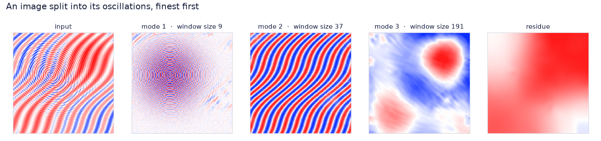
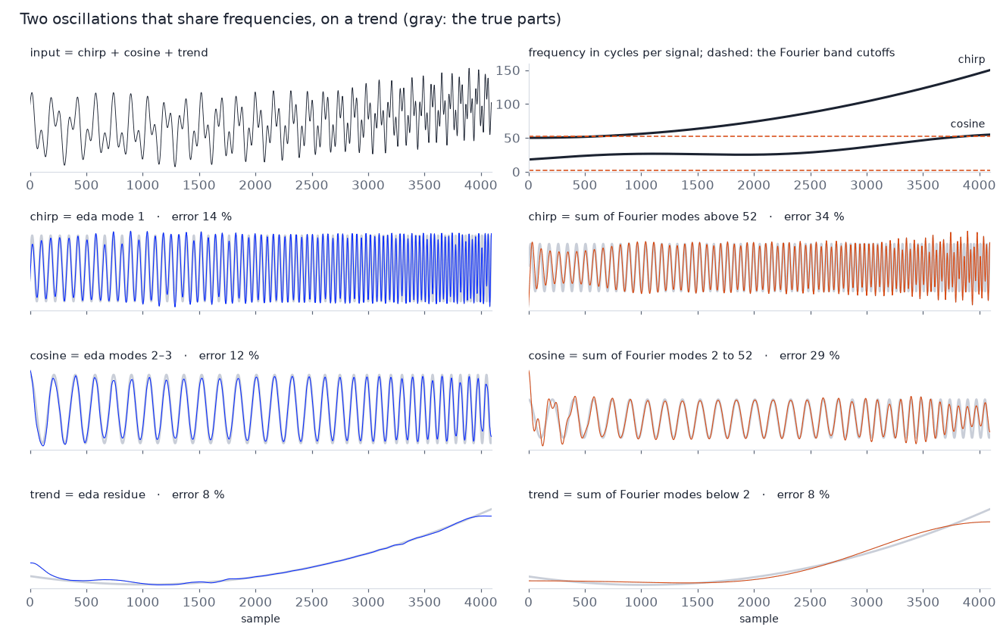
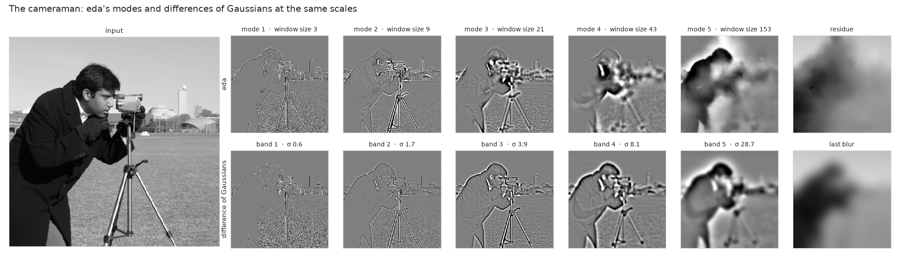
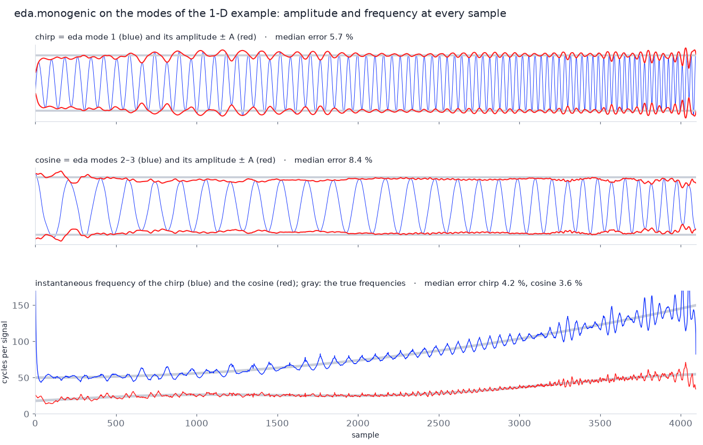
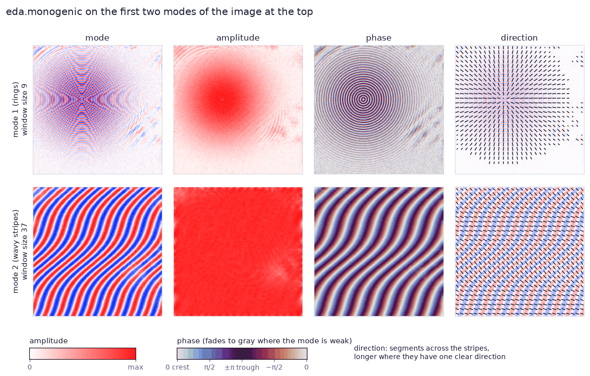

# eda-cuda

**(Empirically) Decompose Anything: N-dimensional empirical decomposition of signals, images and
volumes on NVIDIA GPUs.**

`eda.decompose(x)` breaks a 1-D signal, a 2-D image or a 3-D volume into a few oscillating
components, from the finest to the coarsest, plus a smooth residue. It accepts NumPy and CUDA
arrays, decomposes a whole batch in one call and runs on the GPU, with no CPU fallback.
[User guide](https://github.com/giorgioangel/eda-cuda/blob/main/docs/USAGE.md) ·
[Contributing](https://github.com/giorgioangel/eda-cuda/blob/main/CONTRIBUTING.md)



*The rings, the wavy stripes and the two patches of light come out as separate modes. In every
panel blue is negative, white is zero and red is positive, and each colour is scaled to the
panel's own range.*

## Install

eda-cuda is not on PyPI. You can build it from source, or install one of the prebuilt wheels
attached to each [GitHub release](https://github.com/giorgioangel/eda-cuda/releases).

**From source.** You need Python 3.12 or newer, Linux on x86-64, an NVIDIA GPU of compute
capability 8.0 or newer with a driver for CUDA 13.0 or newer, the CUDA toolkit 13.0 or newer (it
provides `nvcc`) and a C++ compiler that your CUDA toolkit supports. pip fetches the other build
tools by itself, CMake included if yours is missing or older than 3.28.

```sh
pip install git+https://github.com/giorgioangel/eda-cuda
```

From a clone, `pip install .` does the same. By default the build compiles for every supported
GPU generation; with `CUDAARCHS=native` it compiles only for the GPU in your machine, which is
faster. NumPy and cuFFT (`nvidia-cufft`) are installed as dependencies. A CUDA 12 toolkit cannot
build the package directly: use the CUDA 12 wheel below, or build it with `tools/build_wheels.sh`,
which needs Docker (see
[CONTRIBUTING.md](https://github.com/giorgioangel/eda-cuda/blob/main/CONTRIBUTING.md#release)).

**Prebuilt wheels.** Each release has two wheels, which need no CUDA toolkit or compiler. Run
`nvidia-smi` to see which CUDA version your driver supports, then pick the wheel for it:

| Wheel | Built with | cuFFT (installed by pip) | Driver |
|---|---|---|---|
| `eda_cuda-<version>-cp312-abi3-manylinux_2_28_x86_64.whl` | CUDA 13.4 | 12.x (`nvidia-cufft`) | CUDA 13.0 or newer |
| `eda_cuda_cu12-<version>-cp312-abi3-manylinux_2_28_x86_64.whl` | CUDA 12.9 | 11.x (`nvidia-cufft-cu12`) | CUDA 12.3 or newer |

```sh
pip install https://github.com/giorgioangel/eda-cuda/releases/download/v0.1.0/eda_cuda-0.1.0-cp312-abi3-manylinux_2_28_x86_64.whl
```

Install only one of the two: both provide the same Python package, `eda`, built from the same
source. Each wheel works with Python 3.12 and newer, thanks to the stable ABI, and contains
compiled code for GPUs of compute capability 8.0, 8.6, 8.9, 9.0, 10.0 and 12.0, plus PTX for 12.0
that later GPUs compile when the library loads. The wheels need glibc 2.28 or newer
(manylinux_2_28).

## Quick start

```python
import numpy as np
import eda

t = np.arange(2048)
x = (np.sin(2 * np.pi * t / 8) + 2 * np.sin(2 * np.pi * t / 64)
     + 3 * np.sin(2 * np.pi * t / 512)).astype(np.float32)

y, info = eda.decompose(x, return_info=True)  # y: (modes + 1, 2048), the last row is the residue
print(y.shape, info.n_imfs, info.windows)
print(np.abs(y.sum(axis=0) - x).max())        # the rows add up to x
```

The script `examples/quickstart.py` also decomposes a batch of images and prints how closely the
rows add back up to the input.

## Why eda

Fourier analysis describes a signal as a sum of sines and cosines, its Fourier modes, and each of
them has a single frequency and a single amplitude over the whole signal. To separate a signal
into parts with Fourier, you add up the modes that fall into chosen frequency bands. You have to
pick the cutoffs between the bands yourself, because nothing in the data tells you where they
should be, and the same cutoffs then apply from the start of the signal to its end. This works
well for signals that are stationary and linear, but real signals often are neither:

- **Non-stationary signals** change their frequency and amplitude over time. A chirp speeds up, a
  period stretches, a pattern bends. A fixed band then cuts one oscillation into pieces, or mixes
  two of them together (see the figure below).
- **Nonlinear signals** are made of waves that are not sines. Their period changes within each
  cycle, which gives them, for example, sharp crests and wide troughs. Fourier spreads such a
  wave over several harmonics, and these end up in different bands.

eda does not work with fixed frequencies. It measures the scale of the oscillations on the data
itself, at every sample, and tries to give each mode a single oscillation whose amplitude and
frequency are free to change. For example, the wave cos(ωt + 0.8 sin ωt) comes out as one eda
mode, with an error of 0.4 % on 4096 samples. Its Fourier modes sit at 0, ω, 2ω and 3ω, so
splitting it into bands would put about a fifth of its energy into the trend.



*The signal is a chirp plus a cosine whose period changes, on top of a trend. In orange, each part
is the sum of the Fourier modes in one frequency band: below 2, from 2 to 52, and above 52 cycles
per signal. Nothing in the data suggests these cutoffs. We found them by searching for the pair
that keeps the largest of the three errors as small as possible, measured against the true parts,
which is something you can never do with real data. Even so, the chirp starts at a lower
frequency than the one the cosine reaches at its end (top right panel), so whatever bands you
choose, one of the two gets cut. In blue, eda, called with its defaults; its small mode 3 is
counted as part of the cosine. The true parts are drawn in grey, and the errors are relative L2
errors.*

Images have the same problem. A difference of Gaussians (DoG), the band-pass filter behind
Laplacian pyramids and SIFT's blob detector, keeps the detail that lies between two blurs of fixed
width, and it uses the same widths at every pixel. A sharp edge contains detail at every scale, so
each DoG band repeats the outline of the cameraman as a halo, wider in each band. eda's modes take
their scale from the extrema around each pixel instead: the edges end up mostly in the fine
modes, and the coarse modes show whole regions.



*The DoG row uses the same scales as eda's modes. Band k is the image blurred with σ_(k−1) minus
the image blurred with σ_k, where σ_k = w_k/5.3 is the blur that halves the amplitude of a wave
of period w_k, and w_k is eda's window size for mode k. Both rows add up to the original image.
Within 4 pixels of the strong edges (18 % of the image), the three coarsest DoG bands hold 86, 52
and 24 % of their energy, against 58, 48 and 12 % for eda's three coarsest modes. The photograph
is greyscale, so the panels are too: in the modes and bands black is negative, mid-grey is zero
and white is positive, while the residue and the last blur use the photograph's own scale. The
photograph is scikit-image's cameraman (CC0, by Lav Varshney).*

- **Adaptive.** There is no fixed basis and no cutoff to choose. The extrema of the data set the
  scale of each mode, and that scale can change from one sample to the next.
- **N-dimensional.** It works on signals, images and volumes, and in 2-D and 3-D it turns its
  filters to follow the local pattern. A whole batch of fields goes through the GPU in one call.
- **Amplitude and frequency at every sample.** `eda.monogenic` gives the amplitude, phase,
  frequency and direction of every mode at every sample, in 1-D, 2-D and 3-D.
- **Reproducible.** With the same GPU, cuFFT and build, the same input gives the same bits,
  whether it is decomposed alone or as part of a batch, and the modes add back up to the input.

eda is an empirical method, like EMD: it tries to do all this, but nothing proves that it
succeeds on a given signal. It is still affected by mode mixing. Two oscillations of similar
scale can end up in the same mode, and one oscillation can be split over two modes, as happens to
the cosine in the 1-D figure, which comes out in modes 2 and 3. In that example the two
oscillations stay at least a factor of 2 apart in frequency at every moment; the closer they get,
the more they mix. The constants of the method were chosen by experiment, and its sift has no
convergence proof. Check the modes against what you know about your data before you rely on them.

## What it computes

The input is written as a sum of modes, which are oscillations ordered from the finest to the
coarsest, plus a slowly varying residue. To extract a mode, eda looks at what is left of the
input and:

1. finds its significant local maxima and minima, its extrema;
2. measures, from their spacing, how wide the oscillation is at every sample;
3. slides a window of that width over the data and records the largest and the smallest value
   inside it, which gives an upper and a lower envelope;
4. subtracts the midpoint between the two envelopes, which removes the slower content.

Steps 3 and 4 together are called a sift, and eda repeats them three times by default (set by
`sifts`). What remains is the mode. eda subtracts it from the input and starts again on the rest,
until no oscillation is left or `max_imf` modes have been found. In 2-D and 3-D the window is
turned along the local direction of the pattern. When the array has more axes than the ones being
decomposed, each 1-D, 2-D or 3-D field in it is decomposed on its own.

## Amplitude, phase, frequency and direction

A mode is an oscillation whose strength and speed change from place to place. `eda.monogenic`
measures them at every sample: it treats the field around each sample as a local wave and returns
its amplitude A (how strong the wave is), its phase φ (where the sample sits in the wave's cycle)
and its frequency ν (how fast the wave oscillates, in cycles per sample). In 2-D and 3-D it also
returns the direction n across the stripes and the coherence c, which says how clearly the
pattern has one direction (0 for none, 1 for perfect stripes).

```python
y, info = eda.decompose(x, return_info=True)            # x: a 2-D image
m = eda.monogenic(y[: int(info.n_imfs)], axes=(1, 2))   # the modes form the batch
m.amplitude, m.phase, m.frequency, m.direction, m.coherence
```

In 1-D this is the analytic signal, f + iHf = A e^(iφ), with H the Hilbert transform. In 2-D and
3-D the Riesz transforms R_a take the place of the Hilbert transform, and the monogenic signal has
the same form, f + Σ_a e_a R_a f = A e^(I_n φ). Here I_n = Σ_a n_a e_a is an imaginary unit
(I_n² = −1) that points along the local direction n. The frequency is the rate at which the phase
changes along n, ν = (1/2π) ∂φ/∂n. The [user guide](https://github.com/giorgioangel/eda-cuda/blob/main/docs/USAGE.md#monogenic-signal) gives every definition.



*The chirp and the cosine of the 1-D example, as eda separates them. Away from the first and the
last 5 % of the signal, the amplitude stays within a median 5.7 % and 8.4 % of the true 1 and 1.2,
and the frequency within 4.2 % and 3.6 % of the true frequencies. Both are measured on eda's
modes, so they include the errors of the decomposition itself.*



*The first two modes of the image at the top. The direction of the rings is radial, and that of the
wavy stripes turns as they bend. The measured frequency gives a median period of 6.9 pixels for the
rings (the true period is 7) and of 35.2 pixels for the stripes (the true period goes from 27 to
41). The amplitude runs from white (zero) to red. The phase is light at a crest and dark in a
trough, and fades to grey where the mode is weak. The direction is drawn as short segments across
the stripes, longer where the stripes have one clear direction.*

`eda.decompose(..., return_orientation=True)` also returns the direction and the coherence that
eda used to turn its window in each mode. They describe what was left of the input before the
mode was taken out, in the band of the mode's window size, so they can differ from those that
`eda.monogenic` measures on the finished mode.

All the figures on this page are made by `tools/readme_figures.py`.

## How it differs from EMD, BEMD, FIF and ALIF

| Method | Mean of the envelopes | Scale of a mode | Sifting | Dimensions |
|---|---|---|---|---|
| EMD [1] | cubic splines through the extrema | set by the extrema | until a stopping rule is met | 1-D |
| BEMD [2] | surfaces through the extrema | set by the extrema | until a stopping rule is met | 2-D |
| FABEMD [3] | max and min filters, then a mean filter | one window size per mode | once | 2-D |
| FIF, MIF [4] | convolution with a filter, computed with the FFT | one filter length per mode | until a tolerance is met; proven to converge | 1-D, 2-D |
| ALIF, SALIF [5, 6] | convolution with a filter whose length varies | a length that varies along the signal | until a tolerance is met; SALIF proven to converge | 1-D |
| eda | max and min over a window shaped by the local pattern, then averaged over it | a window size per mode, adjusted at every point and turned along the local direction | at most a fixed number of times, 3 by default | 1-D, 2-D, 3-D |

### Window size

eda builds each mode by sliding a window over the data and taking the highest and the lowest
values inside it. For this to work, the window has to be about as long as one wiggle of the
oscillation. The methods above differ in how they choose that length:

1. **One size for the whole mode.** FABEMD and FIF measure the typical wiggle of the mode and use
   that size everywhere. In eda this size is called w, and it is twice the average spacing
   between significant extrema.
2. **A size for every point.** ALIF measures the wiggle where it stands, in 1-D. eda does the
   same in 1-D, 2-D and 3-D: its local size L(x) is the local wavelength, measured from how
   densely the extrema are packed around x, and it mostly stays between w/1.5 and 2w.
3. **A shape for every point.** In 2-D and 3-D, stripes run in a direction, so eda stretches the
   window into a bar laid across them, about one wiggle long and a quarter of that wide, much like
   a ruler laid across floorboards to measure their width. The direction of the bar is called
   n(x).

The figures on this page show all three:

- **1-D.** The chirp speeds up, so its wiggles shrink from 82 to 27 samples. A single size for
  the mode would be about 49 samples everywhere (eda's w is 49), which is too short at the start
  and too long at the end. eda's local size goes from about 82 samples at the start down to 33 at
  the end, which is its lower limit w/1.5.
- **2-D.** The wavy stripes in the image at the top are 27 to 41 pixels apart and bend by about
  35°. eda's window becomes a bar about 27 to 41 pixels long that lies across the stripes and
  turns as they bend.

In more detail, the local size is L(x) = 2/ρ(x), where ρ = (Σ_a ρ_a²)^½ combines the local
densities ρ_a of extrema along each axis a. A wave of period P has ρ = 2/P, so L = P. L is
clipped to [w/1.5, 2w] and then averaged, in log, over a box. L also grows from one mode to the
next in most places, which keeps the modes ordered from fine to coarse.

### Direction

To find the direction across the stripes, eda first keeps only the part of the data with wiggles
about the size of the current mode, and then asks which way those wiggles run. It uses first- and
second-order Riesz transforms, so the direction remains measurable at both crests and troughs.

In more detail, b is the residual filtered by a one-octave log-Gabor filter centred at the frequency
f₀ = 1/w, and R₁ = (R_a b) and R₂ = (R_a R_b b) are its first- and second-order Riesz transforms.
For a plane wave of orientation k̂ and amplitude A, the energy tensor T = R₁R₁ᵀ + R₂R₂ᵀ equals
A²k̂k̂ᵀ at every phase, because sin² + cos² = 1. Unlike the pointwise gradient tensor, it does not
vanish at crests and troughs. The direction n is the top eigenvector of T. It defines an axis rather
than a signed direction: n and −n describe the same orientation. The coherence
c = (μ₁ − μ₂)/(μ₁ + μ₂), computed from the two largest eigenvalues, measures how strongly one
orientation dominates: 0 means no dominant orientation, and 1 means a single dominant orientation.
The window B(x) is a cube of side d = L(1 − 3c/4) swept along ±(3/8)cL·n. It is a cube of side L
where the pattern has no dominant orientation, and a bar of length L across the stripes and L/4
wide where it has one.

### Envelopes

The two envelopes are a running maximum and a running minimum over the window, so, as in FABEMD,
no curves or surfaces are fitted through the extrema. eda then averages their midpoint over the
same window, m = Avg_B((Dil_B h + Ero_B h)/2), where Dil_B and Ero_B are the maximum and the
minimum over B(x). The van Herk/Gil-Werman algorithm computes a running maximum or minimum at a
fixed cost per sample, whatever the size of the window. Because the window changes from point to
point, eda filters with a ladder of cube sizes spaced by a factor of √2 and, at each point,
interpolates between the two nearest sizes on a log scale.

### Which extrema count

Small wiggles caused by noise should not count as oscillations. An extremum therefore counts only
if its prominence, how far it stands out from its surroundings, reaches τ(x) = 0.3·max(λ(x), σ_n).
Here λ is the local RMS of the detail and σ_n is an estimate of the noise level based on the
median absolute deviation. This keeps noise from shrinking w or L.

### Sifting

The first sift subtracts m from the residual; each later sift updates the mode as h ← h − a·m,
where the weight a(x), between 0 and 1, fades the sift out where no oscillation of the mode is
left. eda caps the number of sifts at three by default (`sifts`). It does not offer to sift until
convergence, because its sift is not a contraction and does not settle down. More sifts remove
more of a slower oscillation that leaked into the mode, but they also split noise into more
modes (see the [user guide](https://github.com/giorgioangel/eda-cuda/blob/main/docs/USAGE.md#sifts-per-mode)).

### Borders

At the edges of the data, the filters and transforms reflect the signal at half a sample (the
band filter uses the DCT for this), so nothing assumes that the signal is periodic.

### Scope and references

eda does not include noise-assisted ensembles (EEMD, CEEMDAN) or multivariate decompositions
(MEMD, MvFIF), and unlike FIF and SALIF it comes with no proof of convergence.

1. Huang et al., *Proc. R. Soc. Lond. A* 454 (1998).
2. Nunes et al., *Image Vis. Comput.* (2003).
3. Bhuiyan, Adhami and Khan, *EURASIP J. Adv. Signal Process.* (2008).
4. Cicone and Zhou, *Numer. Math.* (2021); Cicone and Zhou, *NMTMA* (2017).
5. Cicone, Liu and Zhou, *Appl. Comput. Harmon. Anal.* 41 (2016).
6. Barbarino and Cicone, *Numer. Math.* 156 (2024).

## API in brief

```python
y = eda.decompose(x, axes=None, max_imf=-1, *, dtype=None, tie_tolerance=None, sifts=3,
                  check_finite=True, errors="raise", stream=None, return_info=False,
                  return_orientation=False)
m = eda.monogenic(x, axes=None, *, dtype=None, check_finite=True, stream=None)
```

- `x` is a NumPy array, or a CUDA array that supports DLPack or `__cuda_array_interface__`.
- `axes` lists the one to three axes to decompose, and any other axes are treated as a batch. By
  default all axes are decomposed.
- `sifts` is the number of sifts per mode, 3 by default. Fewer sifts give smoother modes; more
  give sharper ones but split noise into more modes.
- The result has a new mode axis in front of the lowest-numbered decomposed axis. Along it come
  the modes (intrinsic mode functions, IMFs) from fine to coarse, then the residue, then rows of
  zeros up to the largest number of modes in the batch. NumPy input returns a NumPy array, and
  CUDA input returns an `eda.DeviceArray`.
- With `return_info=True` the call also returns a `DecompositionInfo`, with the number of IMFs,
  an error code, and the window size, sift count and energy of every mode of every element.
- With `return_orientation=True` (2-D and 3-D) the call also returns an `Orientation`: for every
  mode, the direction across the stripes that eda turned its window to, and how clearly the
  stripes had one direction (the coherence). Asking for it does not change the modes.
- `eda.monogenic` returns the amplitude, phase and frequency of a field at every sample, and in
  2-D and 3-D its direction and coherence (see
  [Amplitude, phase, frequency and direction](#amplitude-phase-frequency-and-direction)).
- `eda.DecompositionError` (a `ValueError`) reports elements that failed, `eda.CudaError` (a
  `RuntimeError`) a failed CUDA call, and `MemoryError` a GPU without enough memory.
- `eda.build_info()`, `eda.device_count()` and `eda.device_info()` describe the build and the
  available GPUs.

The [user guide](https://github.com/giorgioangel/eda-cuda/blob/main/docs/USAGE.md) describes every argument and rule.

## Device arrays

When the input is a CUDA array, eda reads it in place and leaves the result on the GPU; nothing
is copied through the host.

```python
import cupy as cp
import torch
import eda

x = cp.random.default_rng(0).standard_normal((4, 128, 128), dtype=cp.float32)
y = eda.decompose(x, axes=(1, 2))        # eda.DeviceArray, shape (4, modes + 1, 128, 128)
z = cp.asarray(y)                        # CuPy array over the same memory

t = torch.randn(4, 128, 128, device="cuda")
u = torch.from_dlpack(eda.decompose(t, axes=(1, 2)))
```

Each call runs on its own CUDA stream and waits until its input is ready. If the input is written
on another stream, the user guide explains what the caller has to do.

## Guarantees

- **Deterministic.** On the same GPU, with the same cuFFT and the same build, the same input
  gives the same result bit for bit, on every run and from any thread, for `eda.decompose` and
  `eda.monogenic` alike. With different cuFFT versions the results agree up to rounding.
- **Independent of the batch.** An element gives the same result, bit for bit, whether it is
  decomposed alone or at any position in any batch, whatever the other elements contain.
- **Reconstruction.** The rows of an element add up to the element, up to the rounding of the
  subtractions that produced them. The user guide gives the bound that the tests check.

## Limits

- Each decomposed axis can have at most 8192 samples in float32 and 4096 in float64, and needs
  at least 2.
- At most three axes can be decomposed. The input must be float32 or float64; other real types
  need `dtype=`.
- Mirroring a single axis can change the decomposition in 2-D and 3-D, and adding a constant to
  the input can change it in any dimension. Both come from the method itself, not from this
  implementation.
- The method is empirical and gives no mathematical guarantee about its modes. Mode mixing still
  happens: oscillations of similar scale can share a mode, and one oscillation can be split over
  two.
- Results can differ in the last bits between GPU models, cuFFT versions and builds.
- Only Linux on x86-64 and NVIDIA GPUs are supported. CUDA graphs are not used yet.

## Citation

To cite the software, use [CITATION.cff](https://github.com/giorgioangel/eda-cuda/blob/main/CITATION.cff):

```bibtex
@software{angelotti_eda_cuda_2026,
  author  = {Angelotti, Giorgio},
  title   = {eda-cuda: (Empirically) Decompose Anything},
  year    = {2026},
  version = {0.1.0},
  url     = {https://github.com/giorgioangel/eda-cuda}
}
```

## License

eda-cuda is released under the Apache-2.0 license; see [LICENSE](https://github.com/giorgioangel/eda-cuda/blob/main/LICENSE) and [NOTICE](https://github.com/giorgioangel/eda-cuda/blob/main/NOTICE). To contribute,
see [CONTRIBUTING.md](https://github.com/giorgioangel/eda-cuda/blob/main/CONTRIBUTING.md); to report a security issue, see [SECURITY.md](https://github.com/giorgioangel/eda-cuda/blob/main/SECURITY.md).
